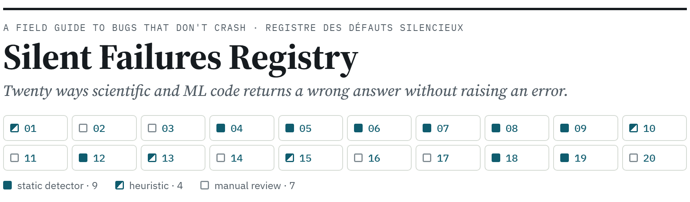

<picture>
  <source media="(prefers-color-scheme: dark)" srcset="assets/registry-dark.png">
  
</picture>

[](https://github.com/AxelNoun/silent-failures/actions/workflows/validate.yml) — the ground-truth fixtures are re-fetched at pinned commits and the detectors re-validated on every push and every Monday.

**A field guide to the bugs that pass the tests and falsify the results** — in scientific and machine-learning code. Twenty classes, each documented from a real, public specimen: the pull request where the pattern was found and fixed, the symptom, the mechanism, the test that would have caught it, and how to prevent it.

**Un guide de terrain des bugs qui passent les tests et faussent les résultats**, dans le code scientifique et d'apprentissage automatique. Vingt classes, chacune documentée à partir d'un spécimen public : la pull request où le défaut a été trouvé et corrigé, le symptôme, le mécanisme, le test qui l'aurait attrapé, la prévention.

→ **Read the registry / Lire le registre : [axelnoun.github.io/silent-failures](https://axelnoun.github.io/silent-failures/)** (EN / FR, one page, no tracking)

## What is in this repository

| Path | What |
| --- | --- |
| `index.html` | the registry page (built, self-contained) |
| `registry/entries.js` | the twenty entries — the single source of truth for the page |
| `registry/template.html`, `registry/build.py` | page template and the build (`index.html` for GitHub Pages; `--fragment` for the bare page) |
| `assets/`, `registry/images.py` | README header and link-preview images, rendered from `registry/entries.js` (`python registry/images.py`; CI checks they are current) |
| `sfradar/` | **sfradar**, a dependency-free static radar for the thirteen classes that have a reliable pattern (AST + regex + taint tracking for pandas views), with its ground-truth validation |

## The twenty classes

| Id | Class | Kind | Specimen |
| --- | --- | --- | --- |
| SF-01 | Grouped-entity leakage across splits | heuristic | PyHealth #1187 |
| SF-02 | Target information inside the features | manual | PyHealth #1203 |
| SF-03 | Negatives sampled from the evaluation set | manual | PyHealth #1202 |
| SF-04 | Non-injective or unstable cache key | static | PyHealth #1207 |
| SF-05 | Assertion that cannot fail | static | ExecuTorch #22373 |
| SF-06 | Exception constructed but never raised | static | ExecuTorch #22373 |
| SF-07 | CI step that stays green on failure | static | python-neo #1912 |
| SF-08 | dtype dropped when lifting a scalar | static | ExecuTorch #22372 |
| SF-09 | In-place mutation of a view that may be read-only | static | DeepLabCut #3445 |
| SF-10 | Unseeded randomness on the evaluation path | heuristic | kinoscope |
| SF-11 | Parameter order coupled across libraries | manual | HSSM #1371 |
| SF-12 | Shared-memory exchange without a fencing barrier | static | mlx-lm #1719 |
| SF-13 | Fast-math transcendental on an unbounded argument | heuristic | mlx-lm #1719 |
| SF-14 | Wrong symbol substituted in generated code | manual | Brian2 #1891 |
| SF-15 | Constant rounded by its printed precision | heuristic | Brian2 #1891 |
| SF-16 | Dangling pointer into a refilled buffer | manual | Brian2 #1893 (fixed in #1896) |
| SF-17 | Narrow integer offset in a vectorized kernel | manual | PyTorch #200949 |
| SF-18 | Exception swallowed | static | PyHealth #1174 |
| SF-19 | Aliased mutable state across samples | static | PyHealth #1203 |
| SF-20 | Test that cannot detect its own regression | manual | PyHealth #1203 |

Each entry on the page carries the maintainer's words verbatim, with a link. Thirteen classes (marked *static* or *heuristic*) are implemented in `sfradar`; seven are *manual* and live in the audit checklist only.

## sfradar in thirty seconds

```bash
cd sfradar
python sfradar-cli.py https://github.com/some/repo        # or a local path
python fixtures/fetch.py && python tests/test_fixtures.py  # reproduce the validation table
```

Validation: the seven ground-truth bug sites are detected at the commit before each fix and clear on the fixed version (7/7, 6/6); a 344-test control repository yields zero findings. Details, known weaknesses and the field run are in [`sfradar/README.md`](sfradar/README.md). It is a radar, not a judge: it ranks where a reviewer should look first.

## Contributing an entry

An entry needs a public specimen (a merged fix, or an issue the maintainers agreed with), a minimal code shape, the test that would have caught it, and the maintainer's words quoted verbatim with a link. Open a pull request against `registry/entries.js`; run `python registry/build.py` to regenerate the page.

## Author

Axel Coiffard-Donaty — [github.com/AxelNoun](https://github.com/AxelNoun). The registry grew out of fixes merged in PyTorch ExecuTorch, PyHealth, Brian2, python-neo, neuroconv, DeepLabCut and HSSM between June and October 2026. AI coding assistants were used in the writing and the implementation, and are credited in the commits; the diagnoses, the specimens and the verification are the author's.

License: MIT for the code and the page; the quoted maintainers' words belong to their authors and are reproduced with attribution and a link.
